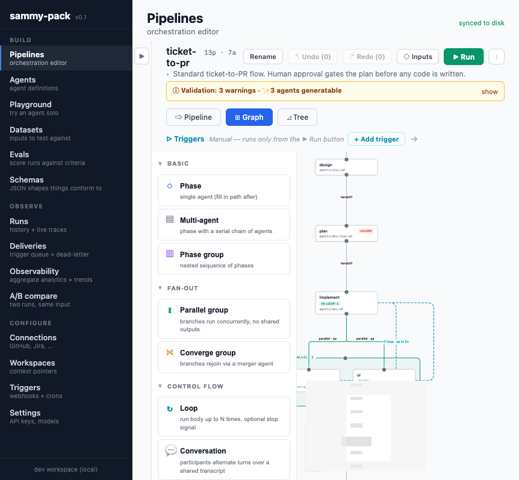
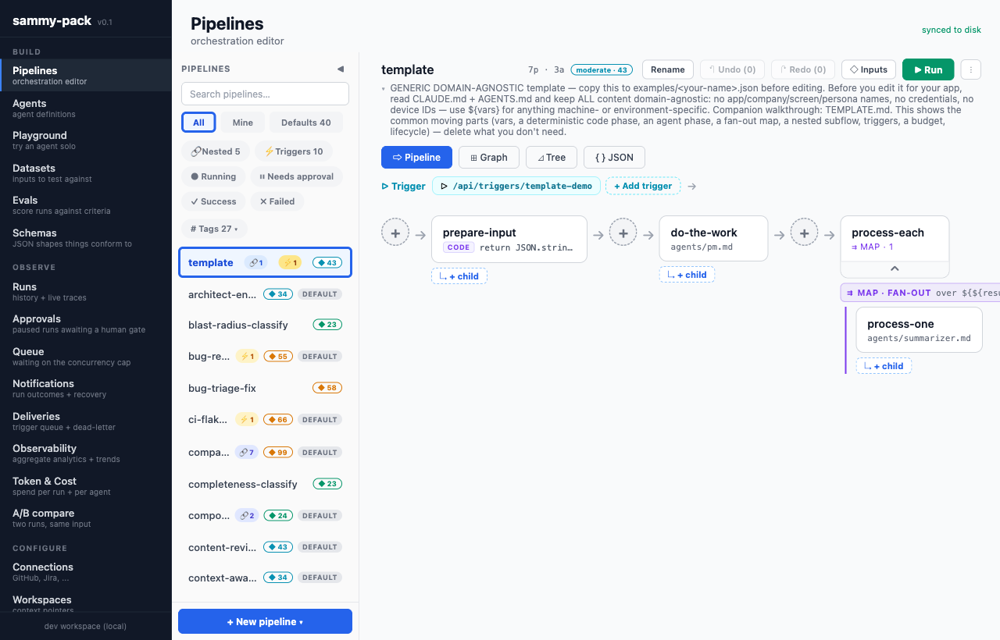
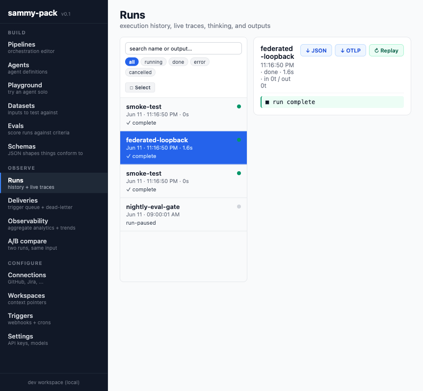

<p align="center"></p>

# sammy-pack

An agent-orchestration framework. Connect your context sources (Jira, GitHub,
Figma, ...), define specialized agents grounded in that context, then compose
them into coordinated multi-agent workflows — and run those workflows with
durable, resumable execution.

Its sweet spot is **software-delivery orchestration**: durable, human-gated,
multi-agent pipelines for the dev lifecycle — multi-persona QA sweeps,
ticket-to-PR, review boards, release gates, incident response — authored once
as JSON and re-run from the web UI, the CLI, a webhook, or a cron. The engine
is general (the examples range from research synthesis to invoice approval),
but delivery/QA pipelines are where it's been exercised hardest.

**A production runtime for Claude-SDK agents.** This is a deliberate stance:
full agentic capability (tools, subagents, MCP) runs through the Claude Agent
SDK, other providers (OpenAI / Gemini / Bedrock) are per-node
*text-generation* routes, and cross-stack interop is the A2A protocol rather
than N reimplementations of tool-calling.

What that buys is **one authoring artifact and one self-hostable system** for
three things usually assembled from separate pieces:

- **Durable execution** — append-only events, per-leaf checkpoints, leases +
  fencing, crash-resume, durable timers and signals.
- **Production failure semantics** — terminal-vs-retryable classification,
  stall recovery, a retry-storm watchdog, partial-fan-out finalize.
- **A human-review surface** — approval gates with request-changes, visual
  evidence, stale-gate TTLs.

One JSON file, runnable on a laptop or on N servers + M workers.



| Pipelines — tag-filterable library | Runs — live traces, replay, OTLP export |
| --- | --- |
|  |  |

Two ways to invoke an orchestration over the same source of truth:

- **Claude CLI** — `.claude/skills/sammy-pack/SKILL.md` exposes orchestrations
  as a skill. Subagents are dispatched via Claude Code's Agent tool. Parity
  with the web executor is enforced by a test (see below).
- **Web** — React Native Web app (Vite). The dev server owns a real
  execution engine: it walks the orchestration tree, dispatches each leaf
  agent via the Claude Agent SDK, streams events over SSE, and persists every
  run to SQLite so it survives a tab close or a server restart.

The orchestration JSON is the single source of truth both surfaces read.

## Status

**Working product, single-tenant.** The execution engine, durability layer,
pipeline editors, and AI-assist features are all built and exercised
end-to-end. It runs as a Vite dev server, as a standalone `http` server
(`app/serve.ts`) and as a standalone delivery worker (`app/worker.ts`), on
SQLite by default or Postgres via `DATABASE_URL` (N servers + M workers, with
leases and fenced writes). What it is *not* yet: multi-tenant (one workspace,
one credentials file, one budget file), and not a hosted product with a login
— auth is an optional bearer token or a JWT verifier you bring, plus two
roles. The mobile targets are scaffolded but not a shipping surface — web is
the live UI. The table below is the capability inventory; the caveats after it
are the limits that go with it.

See [`docs/architecture.md`](docs/architecture.md) for the execution model.

### What's built

| Area | State |
| --- | --- |
| Orchestration schema | 14 node body kinds + decorators; JSON-Schema validated; parity-tested against the executor, CLI skill, and preview |
| Authoring | JSON (single source of truth) **or** the code-first TypeScript DSL in the `sammy-pack` core package — compiles to the same JSON |
| Execution engine | Server-owned: walks the tree, dispatches agents via the Claude Agent SDK |
| Durability | SQLite or Postgres run store; append-only events; checkpoints after each leaf phase; per-run leases with fenced status writes |
| Resume | Lock-gated phases snapshot + pause; `Resume` re-runs from the checkpoint (skip-replay) |
| Durable waits | `wait` node — durable timers (`seconds`/`until`, zero-cost park, survives restarts) + external signals (`POST /api/runs/:id/signal`, FIFO buffering) |
| Deploy | Dockerfile + docker-compose: single-node SQLite by default, `--profile postgres` for N servers + M workers |
| Crash handling | Orphaned `running` rows (expired lease) flagged `interrupted` on boot, on a re-scan and on a periodic sweep, with their concurrency group released; auto-resume from the checkpoint is opt-in (`SAMMY_AUTO_RESUME=1`, server only, resume-before-drain — the worker marks and drains but never resumes). A terminal write that keeps failing tears the leg down rather than leaving a lease-renewing zombie; a leg that loses its lease persists nothing further |
| Streaming | SSE — `run-start` → phase events → terminal sentinel; survives reconnect |
| Cancel | Aborts the SDK subprocess mid-call; classifies the run as `cancelled` |
| Editors | Pipeline (linear), Graph (`@xyflow/react`, composites expand inline), Tree, raw JSON |
| AI-assist | Generate an orchestration from a spec/PRD, **or drop a diagram / PRD / image** and have it extracted |
| Agent matching | Diagram-derived agent names fuzzy-matched to the workspace; one-click generate any missing |
| I/O contracts | A node's inline `input` / `output` JSON Schema is enforced at runtime **on leaf nodes** (`agent`, `code`, `wait`, `a2a`) — a mismatch is a phase error. On composites (`phases`, `parallel`, `map`, `loop`, `route`, `switch`) the contract is **not** checked; the validator warns instead (`composite-contract`, advisory) |
| Sandbox policy | Per-node + run-wide `sandbox`: tool allowlist, Bash command denylist, network toggle, permission-mode floor (tighten-only) |
| Run fork | Fork a finished run at any phase — replays completed leaves from checkpoint, re-executes from there |
| Trace export | OTLP/JSON with OTel `gen_ai.*` semantic conventions — one span per phase; opt-in push to any OTLP collector at run terminal (`SAMMY_OTLP_ENDPOINT`) |
| Metrics | Prometheus text exposition at `/metrics` — run/agent-slot/parked-wait gauges, low-cardinality by design |
| Auth | Optional bearer-token gate (`SAMMY_API_TOKEN` locks mutating `/api` routes; `SAMMY_REQUIRE_AUTH_READS=1` gates reads too — the SSE stream, the root `/metrics` and the A2A discovery card included) and optional JWT verifier (HS256 / RS256 / JWKS) that **compose** — a bearer is the token *or* a verifiable JWT — two roles (`read` / `write`) from a claim or an allowlist, owner scoping on runs / A2A tasks / deliveries / credentials; under any token or verifier posture an unauthenticated trigger fire runs as `system` |
| API contract | OpenAPI 3.1 document for the whole `/api` surface, served at `/api/openapi.json` |
| Budget caps | Server-enforced global daily / monthly USD ceiling plus optional per-owner caps — a run is refused when either is reached (the refusal names the cap that bit), halted if it crosses one mid-flight; all four editable in Settings and over `PUT /api/budget`; failed and retried attempts are charged |
| A2A protocol | Inbound (each orchestration is an A2A agent) + outbound (the `a2a` node calls a remote A2A agent) |
| Run store | Pluggable — SQLite by default (zero infra), Postgres via `DATABASE_URL` |
| Pages | Pipelines, Runs, Agents, Datasets, Evals, Observability, Schemas, Workspaces, Playground, Settings |

### Honest caveats

- **Identity is a seam, not a full layer.** Runs carry an `owner_id`, and
  the run routes, the A2A task methods, deliveries, the concurrency view and
  credential visibility enforce it (a mismatch answers 404). But the identity
  itself comes from an `X-Sammy-User` header that the server trusts as-is
  unless a JWT verifier is configured, and reads are ungated by default.
  **For a multi-user deployment set `SAMMY_REQUIRE_AUTH_READS=1` and a JWT
  verifier**; without both, owner scoping is a UI convenience rather than a
  control, because an unauthenticated caller picks the header value. A static
  `SAMMY_API_TOKEN` composes with the verifier but identifies nobody — every
  token holder is one shared admin. Under gated reads the browser's event
  stream sends that credential as `?token=`, which a proxy's access log will
  see; `docs/deployment.md` gives the mitigations. What exists beyond that is
  two roles (`read` / `write`) and per-owner spend caps under a global
  ceiling. There is no login flow, no per-resource permission and no
  multi-tenancy — one instance per team is the supported shape.
- **Agentic capability is Claude-native by design.** Tool use, subagents,
  and MCP run through the Claude Agent SDK; the other providers
  (OpenAI / Gemini / Bedrock) are per-node **text-generation** routes, not
  full agent harnesses. The cross-stack answer is A2A: instead of
  re-implementing tool-calling per provider, an `a2a` phase calls an agent
  built on any stack that speaks the protocol.
- **Sandbox is policy-level, not OS-level.** The `sandbox` decorator strips
  tools and pins the permission mode *before* dispatch; its Bash command
  denylist, though, is a **post-hoc backstop** — matched when the tool-use
  event arrives, by which point the SDK has usually already started the
  subprocess, so the phase fails but the command may have run. Real
  defense-in-depth, but not container/VM isolation. A tool-equipped agent
  still runs in the server process, and `code.source`'s `node:vm` context is
  handed real host objects, so it is not a boundary against a *malicious*
  author either. Treat authoring access to orchestration JSON as shell access
  on the host.
- **Trigger → run is at-least-once.** A delivery is settled after its run is
  created; a worker crash in that window re-queues the delivery and a second
  run is created for one fire. Idempotency keys dedupe repeated *fires*, not
  this window — design downstream effects to tolerate a duplicate.
- **Replay is skip-replay, not deterministic re-execution.** `sammy replay`
  feeds recorded leaf outputs back and diffs the control flow; it does not
  re-run agents or prove the same outputs would recur.
- **Mobile** — the iOS/Android RN projects exist but aren't a maintained
  surface. Web is the target.

## Documentation

[`docs/README.md`](docs/README.md) is the index. The short version:

| Doc | Read it when |
| --- | --- |
| [`docs/getting-started.md`](docs/getting-started.md) | you just cloned — clone → first run in ~5 minutes |
| [`demo/README.md`](demo/README.md) | you want to see it work end to end — a ticket becomes a PR, then intake, approvals, worktrees and artifacts, all runnable locally |
| [`docs/patterns.md`](docs/patterns.md) | you're designing an orchestration and want the catalog of shapes |
| [`docs/schema.md`](docs/schema.md) | you need the formal spec for a node kind or decorator |
| [`docs/architecture.md`](docs/architecture.md) | you want to know how execution, durability, and parity actually work |
| [`docs/triggers.md`](docs/triggers.md) | you want webhooks / cron / polling / event-chained runs |
| [`docs/deployment.md`](docs/deployment.md) | you're running it as a real server — auth, Postgres, workers, spend caps |
| [`docs/a2a.md`](docs/a2a.md) | you're wiring it to other agents over the A2A protocol |
| [`docs/calibration.md`](docs/calibration.md) | you use LLM-judge agents and want to measure / improve their accuracy |
| [`docs/context-engineering.md`](docs/context-engineering.md) | your runs need retrieval, compaction, or cross-run memory |

## Orchestration shape (quick reference)

Every node has exactly one **body kind**:

| Key            | Meaning                                                                |
| -------------- | ---------------------------------------------------------------------- |
| `agent`        | leaf — path to a single agent                                          |
| `agents`       | composite — serial chain of agents in one phase                        |
| `phases`       | composite — nested serial phases (recursive)                           |
| `parallel`     | composite — concurrent branches                                        |
| `converge`     | composite — concurrent branches resolved by a `merger` agent           |
| `loop`         | composite — refine up to N iterations; `until` / `whileOutput` / `judge` |
| `conversation` | composite — alternating-turn dialogue between agents                   |
| `route`        | composite — router-agent or substring-matched branching                |
| `map`          | composite — fan-out over an array; `${item}` / `${index}` per iteration |
| `switch`       | composite — value-matched branching over labelled `cases` (`${expr}`)   |
| `subflow`      | composite — inline another orchestration by name                       |
| `code`         | leaf — run code: `source` in a `node:vm` sandbox, or `run` a shell command (opt-in) |
| `wait`         | leaf — durable park: a timer (`seconds` / `until`) or an external `signal` |
| `a2a`          | leaf — dispatch the phase to a remote agent over the A2A protocol       |

That is the schema's full set of 14; `docs/schema.md` describes each.

Per-node decorators: `lock` (human-approval gate), `as` (name the output for
`${interpolation}`), `when` (skip predicate), `prompt` (literal message
override), `retry`, `timeout`, `onError`, `budget`, `tools`, `maxTurns`,
`continueOnError`, plus top-level `vars`. Full spec in
[`docs/schema.md`](docs/schema.md); the schema itself is
[`schema/orchestration.schema.json`](schema/orchestration.schema.json).

## Layout

```
sammy-pack/
├── .claude/skills/sammy-pack/SKILL.md   # CLI runner — kept at parity with the web executor
├── agents/                              # agent definitions (markdown + frontmatter)
│   └── orchestration-designer.md        # the AI-assist designer agent
├── context/                             # workspace pointers (which repo / branch / paths)
├── docs/                                # docs/README.md is the index
│   ├── getting-started.md               # clone → first run walkthrough
│   ├── schema.md                        # orchestration config spec
│   └── architecture.md                  # execution model, durability, connectors
├── schema/orchestration.schema.json     # JSON Schema (the parity contract)
├── examples/                            # reference orchestrations
├── runs.db                              # SQLite run store (gitignored)
└── app/
    ├── sammy-pack-api.ts                # Vite dev-server middleware: REST + SSE + run lifecycle
    ├── src/
    │   ├── server/                      # server-only: db, run-controller, sdk-stream,
    │   │                                #   file-extractor, agent-matcher
    │   ├── llm/executor.ts              # the orchestration executor (tree walk + composites)
    │   ├── pages/                       # Pipelines, Runs, Agents, Evals, Observability, ...
    │   ├── store/runs.tsx               # client run store (SSE consumer)
    │   ├── GraphEditor.web.tsx          # node-graph editor
    │   └── types.ts
    ├── __tests__/                       # Jest — incl. cli-parity.test.ts (drift detector)
    └── vite.config.ts
```

## Running the app

**Prerequisites:** [Node.js](https://nodejs.org) **22 LTS** (`.nvmrc` pins it —
run `nvm use` to select it) and npm. That's the only system requirement — no
Python or C++ build tools needed: on Node 22, `npm install` pulls a prebuilt
SQLite binary for Windows, macOS, and Linux (x64/arm64).

```bash
cd app
npm install
npm run build:web && npm run serve   # http://localhost:5173 — for real runs
```

`npm run serve` is the standalone server: the web app plus the full API,
with no file watching, so runs are never interrupted by an edit. While you
work on sammy-pack itself, use the hot-reloading dev server instead — but
know that saving a server file restarts it and interrupts any run in
flight (an interrupted run can be resumed from the Runs page):

```bash
npm run web              # dev server with hot reload, http://localhost:5173
npm test                 # Jest suite
npm run typecheck        # tsc --noEmit
./sammy-pack start       # the dev server in the background; also stop | restart | status | logs
```

**Security defaults.** The server binds to `127.0.0.1` and, until you set
`SAMMY_API_TOKEN`, every mutating `/api` route is open to anything that can
reach it — fine on your own machine, never on a shared one. Before exposing
it, set `SAMMY_API_TOKEN` (and a JWT verifier for per-user identity); the
boot banner in the log states the posture it is running with.
[`docs/deployment.md`](docs/deployment.md) covers auth, roles and the
`code.run` allowlist.

First time here? [`docs/getting-started.md`](docs/getting-started.md) walks
from clone to a first running orchestration. For standalone-server / worker /
Postgres deployment, see [`docs/deployment.md`](docs/deployment.md).

The dev server (`sammy-pack-api.ts`) needs the Claude Agent SDK's auth —
it reads your Claude Code CLI login from `~/.claude/`. Run `claude` once in a
terminal to confirm you're logged in; no separate API key is required for the
server-owned run path.

## Known limitations

An early release — these are known, and on the list:

- **The web app is slow to load** — several seconds on a first visit, and
  the Graph view is the slowest to open. The cost is style processing in the
  React Native Web layer; the API itself answers in milliseconds.
- **Agentic steps run on the Claude Agent SDK.** Other providers
  (OpenAI, Gemini, Bedrock) are text-generation steps only.
- **The process cleanup at the end of a run is best-effort.** It stops the
  run's agents, anything they spawned, and anything still running inside the
  run's worktree; a process an agent detaches somewhere else can survive.
- **`deniedCommands` matches by substring.** Keep patterns specific.
- **Not yet on npm** — install from source as above.

## Cross-platform (macOS / Linux / Windows)

The toolkit runs on macOS, Linux, and Windows. The web app, CLI, executor,
and dev-server API are all platform-agnostic (paths go through `node:path`;
no `.sh` is needed to build or run). Setup is identical:

```powershell
cd app
npm install
npm run web              # http://localhost:5173
npm test
npm run typecheck
```

Windows specifics:

- **Auth** reads from `%USERPROFILE%\.claude\` (the Claude Code CLI manages
  it). Run `claude` once to log in — same as macOS/Linux.
- **Agent / orchestration import** (Settings → Agent sources) prefers
  *symlinks* so source edits read live. On Windows, symlinks require
  **Developer Mode** (Settings → For developers) or an elevated shell; without
  it, imports automatically fall back to a **copy** (the UI says how many) —
  copies don't track later source edits, so re-import to refresh.
- **`code.run` phases** execute through the system shell — `sh` on
  macOS/Linux, `cmd.exe` on Windows — so keep those command strings shell-
  portable if an orchestration must run on both.
- **Line endings** are normalized to LF via `.gitattributes`; clone fresh on
  Windows so checkouts match (avoids CRLF noise and keeps the `sammy` CLI
  shebang valid).

If `npm install` ever tries to *compile* the SQLite binary (only on an
unusual platform/Node combo with no prebuilt binary), install the toolchain:
on Windows `npm i -g windows-build-tools` or the "Desktop development with
C++" workload + Python 3; on Linux `build-essential` + `python3`; on macOS
the Xcode command-line tools. Staying on Node 22 LTS avoids this entirely.

## CLI ↔ web parity

`.claude/skills/sammy-pack/SKILL.md` and `app/src/llm/executor.ts` must agree
on every schema-declared node kind and decorator — the same orchestration JSON
should behave identically whether launched from the CLI or the web UI.
`app/__tests__/cli-parity.test.ts` guards the *coverage* half of that: it
scans the schema and fails if a property or body kind is not mentioned in
`SKILL.md` or referenced in `executor.ts`. That is a word-presence check — a
field both files name but handle differently passes it. Semantic parity
rests on the lifecycle suites and on `preview.parity.test.ts` (the dry-run
preview must resolve exactly as the live executor does);
`schema-parity.test.ts` pins the schema's enums and numeric bounds to the
runtime's.

## License

[MIT](LICENSE) © 2026 qvhn. Use it, fork it, ship it.
